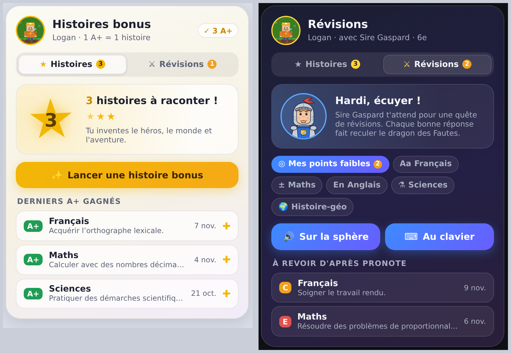

# Story Bonus Card (FR)

Carte Home Assistant des **sphères vocales** (assistant ESPHome), en deux onglets :

- **Histoires** : chaque **A+** gagné dans Pronote rapporte une histoire bonus où l'enfant invente tout. Compteur d'histoires, derniers A+ gagnés.
- **Révisions** : quêtes de révisions avec **Sire Gaspard**, par matière ou ciblées sur les **points faibles Pronote** (compétences fragiles ou insuffisantes récentes).

Tout se lance **sur la sphère (à voix haute)** ou **au clavier**, directement dans la carte. Style verre, thème clair/sombre automatique, éditeur visuel, textes en français.



*Aperçu avec des données de démonstration : onglet Histoires (clair) et onglet Révisions (sombre).*

## Installation (HACS)
HACS → ⋮ → Dépôts personnalisés → URL de ce dépôt, catégorie **Tableau de bord** → installer → recharger la page.

## Prérequis
- Un **compteur** d'histoires bonus (ex. `counter.logan_histoires_bonus`) incrémenté à chaque nouvel A+.
- Un **script** qui lance l'histoire sur la sphère et décrémente le compteur (ex. `script.logan_histoire_bonus`, avec un champ `satellite`).
- Pour les révisions sur la sphère : un script de révisions (ex. `script.logan_revisions`, champs `satellite` et `matiere`).
- Facultatif : l'intégration [Pronote pour Home Assistant](https://github.com/delphiki/hass-pronote) pour afficher les derniers A+.

## Configuration
```yaml
type: custom:story-bonus-card
counter: counter.logan_histoires_bonus
script: script.logan_lancer_une_histoire_bonus
satellite: assist_satellite.sphere_logan_assist_satellite
agent: conversation.prof_6e                # mode clavier
age: 11
revision_script: script.logan_revisions_avec_sire_gaspard
niveau: 6e
pronote: sensor.pronote_nom_prenom_class   # facultatif
name: Logan
image: /local/image/pixel.png              # facultatif
```

| Option | Description |
|---|---|
| `counter` | Compteur d'histoires bonus (`counter`, `input_number` ou `sensor`) |
| `script` | Script appelé par le bouton (reçoit `satellite`, ou `clavier: true` en mode clavier) |
| `satellite` | Sphère / satellite Assist qui raconte l'histoire |
| `agent` | Agent de conversation pour le mode clavier (ex. `conversation.prof_6e`) |
| `age` | Âge de l'enfant, pour adapter l'histoire au clavier (11 par défaut) |
| `pronote` | N'importe quel capteur Pronote de l'enfant (pour les derniers A+) |
| `name` | Prénom affiché |
| `image` | Personnage ou photo (ex. `/local/image/pixel.png`) |
| `title` | Titre (`Histoires bonus` par défaut) |
| `level` | Compétence qui rapporte une histoire (`A+` par défaut) |
| `max_recent` | Nombre de derniers A+ affichés (3 par défaut, 0 pour masquer) |
| `confirm` | Demande « Oui, raconte ! » avant de lancer (`true` par défaut) |
| `revisions` | Affiche l'onglet Révisions (`true` par défaut) |
| `revision_script` | Script de révisions sur la sphère (reçoit `satellite` et `matiere`) |
| `revision_image` | Image de Sire Gaspard (par défaut celle du dépôt sphere-ai-images) |
| `niveau` | Niveau scolaire (`6e` par défaut) |
| `revision_days` | Points faibles Pronote pris sur N jours (30 par défaut) |
| `default_tab` | `histoires` ou `revisions` |
| `theme` | `auto`, `light`, `dark` |

## Révisions
Choisis une matière (Mes points faibles, Français, Maths, Anglais, Sciences, Histoire-géo) puis **Sur la sphère** ou **Au clavier**. « Mes points faibles » s'appuie sur les compétences « fragile » ou « insuffisante » de Pronote des derniers jours, listées sous les boutons. Au clavier, « J'ai fini (bilan) » demande à Sire Gaspard le bilan des pièces d'armure et l'adoubement.

## Mode clavier
Avec `agent` renseigné, le bouton propose **Sur la sphère** ou **Au clavier**. Au clavier, l'histoire se joue dans la carte comme une discussion : le conteur pose ses 3 questions, raconte, et propose des choix numérotés (boutons « Choix 1, 2, 3 » ou réponse libre). Le script est appelé avec `clavier: true` pour décompter l'histoire sans rien lancer sur la sphère.

## Apparence : nuance de couleur

| Option | Valeurs |
|---|---|
| `nuance` | `theme` (par défaut), `braise`, `ocean`, `lagon`, `foret`, `lavande`, `framboise`, `ambre`, `ardoise`, `perso` |
| `nuance_perso` | Couleur au choix (sélecteur de couleur), utilisée avec `nuance: perso` |
| `intensite` | De `0` (neutre) à `2` (très coloré), `1` par défaut |

**Une seule nuance pour toutes les cartes Johan854** : laisse `nuance: theme` et ajoute à ton thème Home Assistant :

```yaml
carte-nuance: "#2f8fd8"
```
